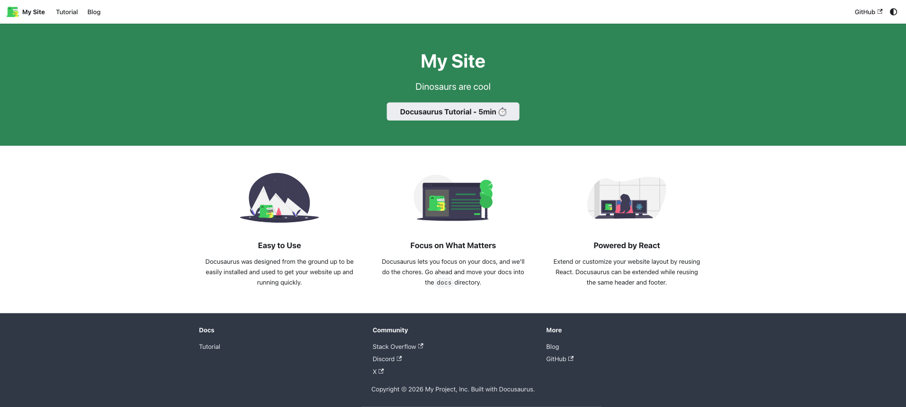
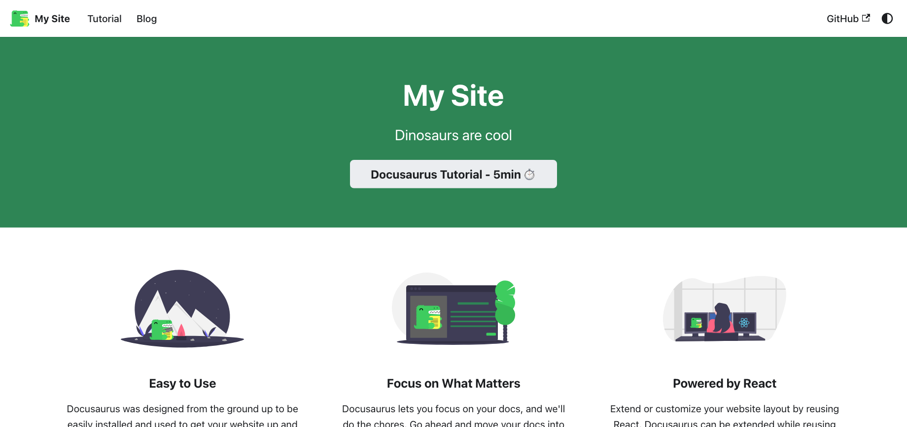

# Repro: facebook/docusaurus#8824

Issue: https://github.com/facebook/docusaurus/issues/8824

**Result: not a Docusaurus bug. The "Chrome" screenshot of the issue shows the same page at 67% browser zoom. Tested with Docusaurus `4.0.0-canary-6975` and `2.4.0`.**

## The bug

On Windows 10, the scaffolded classic site looked smaller in Chrome than in Edge: smaller fonts, smaller paddings.

In the Chrome screenshot, everything is 2/3 of its size in the Edge screenshot, including the feature images that have a fixed `200px` size. A CSS difference can't scale fixed pixel sizes. Browser zoom does. Chrome remembers zoom levels per host, so a zoom level set for another app on `localhost` also applies to the Docusaurus server.

## Setup

- The unmodified `classic` template of `npx create-docusaurus@4.0.0-canary-6975 site classic --javascript`, with exact versions.
- `scripts/computed-styles.mjs`: prints the computed font, sizes, paddings and margins of the elements of the screenshots (navbar, hero banner, features, footer).
- `scripts/zoom-screenshots.mjs`: screenshots the homepage like the two windows of the issue, on a Windows display scaled to 125%: browser zoom 100% (Edge) and 67% (Chrome).

## Steps

Requires Node.js >= 24.21.

```bash
npm install
npx playwright-core install chromium-headless-shell
```

Development server:

```bash
npm start
# in another terminal
node scripts/computed-styles.mjs http://localhost:3000/ > dev.json
```

Stop it, then production build:

```bash
npm run build
npm run serve
# in another terminal
node scripts/computed-styles.mjs http://localhost:3000/ > prod.json
diff dev.json prod.json
node scripts/zoom-screenshots.mjs http://localhost:3000/
```

## Expected result

`diff dev.json prod.json` prints nothing: development and production render the same fonts, sizes and paddings. The font is the system font stack (`system-ui, -apple-system, "Segoe UI", ...`), so Segoe UI on Windows, in both browsers.

The zoom screenshots match the issue screenshots. They are cropped differently at the top, so compare the height of the green hero banner:

| Window                         | Issue screenshot | `screenshots/` |
| ------------------------------ | ---------------- | -------------- |
| Edge, zoom 100% (DPR 1.25)     | 387px            | 387.7px        |
| Chrome, zoom 67% (DPR 0.83)    | 259px            | 258.4px        |

| Issue: Chrome | Repro: zoom 67% |
| --- | --- |
|  |  |

| Issue: Edge | Repro: zoom 100% |
| --- | --- |
|  |  |

In Chrome, a magnifier icon in the address bar means the zoom isn't 100%. `Ctrl+0` resets it, and `chrome://settings/content/zoomLevels` lists the zoom level of each host.

## Docusaurus 2.4.0

The version of the issue renders the same styles. In another folder:

```bash
npx create-docusaurus@2.4.0 site-v2 classic --package-manager npm --skip-install
cd site-v2
npm pkg set overrides.webpack=5.75.0
npm install --legacy-peer-deps
npm run build
npm run serve
```

Then from this repro:

```bash
node scripts/computed-styles.mjs http://localhost:3000/ > v2.json
diff prod.json v2.json
```

`diff` prints nothing.
