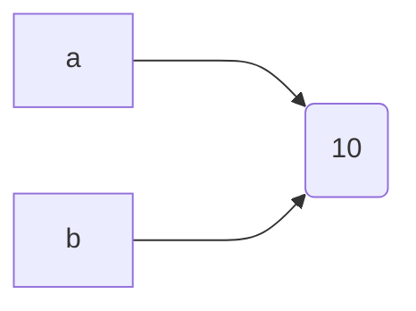
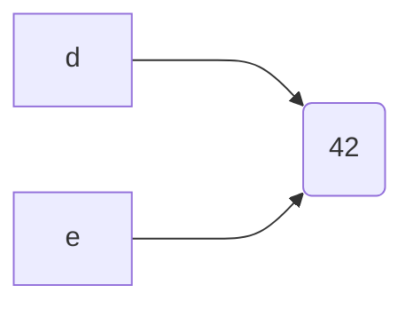

# Mermaid in tabs

Code from the issue. Switch to `tab-b`: the arrows must be displayed.

import Tabs from '@theme/Tabs';
import TabItem from '@theme/TabItem';

<Tabs>
<TabItem value="tab-a">

The following mermaid diagram is shown:

</TabItem>

<TabItem value="tab-b">

This mermaid diagram is not displayed:

</TabItem>
</Tabs>
